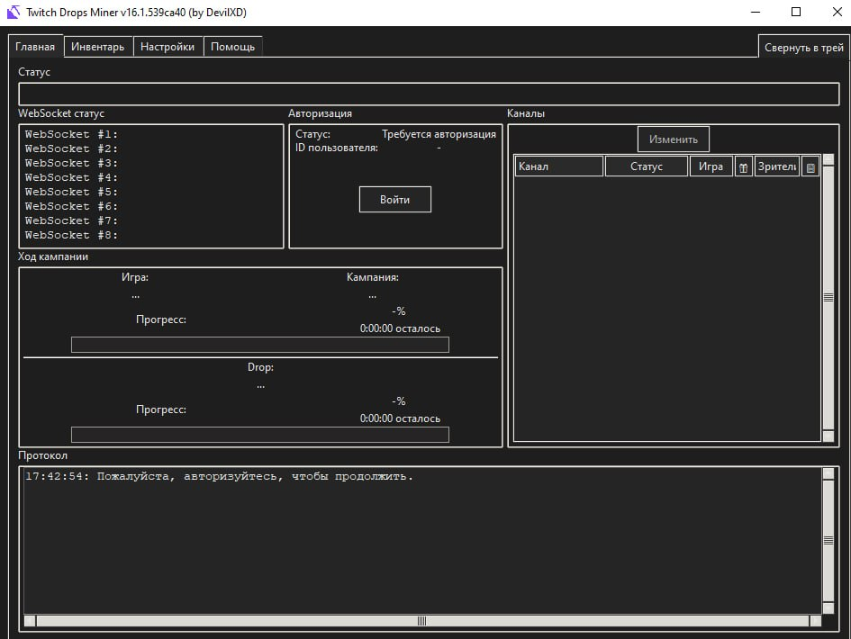
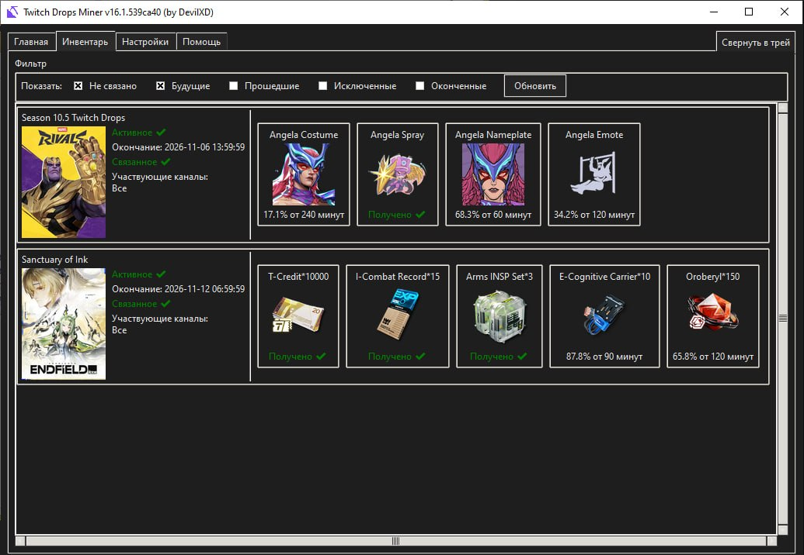
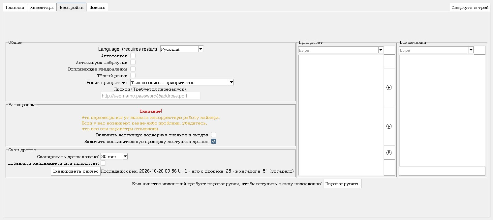

# Twitch Drops Miner

> **Неофициальная fix-сборка (форк)** - форк [DevilXD/TwitchDropsMiner](https://github.com/DevilXD/TwitchDropsMiner)
> с исправлениями под изменения API Twitch сентября-октября 2026, из-за которых апстримовский
> `development build` не мог ни залогиниться, ни увидеть ни одной кампании
> (issue апстрима [#1165](https://github.com/DevilXD/TwitchDropsMiner/issues/1165)).
> Все права на само приложение принадлежат DevilXD и контрибьюторам апстрима; этот форк несёт
> только фиксы и упаковку, нужную чтобы оно работало.
> Подробности - в разделе [Заметки о форке](#заметки-о-форке-что-меняет-эта-сборка).
>
> [English version](README.en.md)

**Какую сборку брать:** версионные релизы этого форка (например `v16.1`) - полные: Windows,
macOS, Linux AppImage (x86_64/aarch64) и Linux PyInstaller (x86_64/aarch64), имена файлов такие
же, как у апстрима, поэтому сборку можно распаковать поверх уже установленной и сохранить
`settings.json` и логин. Больше ничего как релиз не публикуется: у форка один полный проверенный
выпуск на версию, а каждый пуш собирается и остаётся артефактом прогона на странице Actions, а не
«движущимся» пре-релизом.

Приложение позволяет фармить timed Twitch drops в режиме AFK: не нужно думать о переключении
каналов, когда тот, что вы смотрите, уходит в офлайн, забирать дропы и даже получать сам
поток - вместо этого приложение делает всё нужное для зачёта времени. Экономит трафик и нервы.

### Как это работает:

Каждые несколько секунд приложение «делает вид», что смотрит конкретный стрим - запрашивая
метаданные потока. Этого достаточно для зачёта минут дропа, при этом скачивание видео и звука
полностью исключено. Чтобы статусы каналов (ONLINE или OFFLINE) оставались актуальными,
устанавливается websocket-соединение, по которому приходят события о запуске и завершении
стримов, а также об изменении числа зрителей.

### Возможности:

- Фарм дропов без потока - экономия трафика.
- Списки приоритетов и исключений игр: можно фармить то, что нужно, в нужном порядке, и
  игнорировать всё остальное.
- Шардированное websocket-соединение: одновременно отслеживается до `199` каналов.
- Автоматический поиск кампаний дропов по привязанным аккаунтам (саму [привязку аккаунтов](https://www.twitch.tv/drops/campaigns) нужно сделать самостоятельно).
- Проверка тегов потока и кампаний дропов - чтобы не тратить время на стрим, который не даст
  зачёта.
- Автоматическое переключение каналов: и когда текущий канал уходит в офлайн, и когда в онлайн
  выходит канал с игрой более высокого приоритета.
- Сессия логина сохраняется в файле cookies - логиниться каждый раз не нужно.
- Фарм запускается сам, как только появляются новые кампании, и останавливается, когда последние
  доступные дропы добыты.

### Использование:

- Скачайте и распакуйте [последний релиз](https://github.com/RoninOnis/TwitchDropsMiner/releases) - рекомендуется держать его в той папке, в которой он поставляется.
- Запустите и подключите майнер к своему аккаунту Twitch через форму логина в приложении.
- После успешного логина приложение получит список доступных кампаний и игр, за которые можно
  фармить дропы - выберите нужные игры и добавьте их в список приоритетов на вкладке Settings,
  затем нажмите `Reload`, чтобы начать обработку. Приложение получит список подходящих стримов и
  сразу начнёт фарм. При необходимости канал можно переключить вручную.
- Если вы хотите, чтобы майнер занимался фармом всего, что можно, помимо выбранных в списке
  приоритетов игр, задайте порядок фарма остальных игр через настройку Priority Mode.
- Обязательно привяжите свой аккаунт Twitch к игровым аккаунтам на [странице кампаний](https://www.twitch.tv/drops/campaigns) - так доступных для фарма игр станет больше.

### Скриншоты:

Сверху вниз: вкладка «Главная», инвентарь кампаний и настройки.

### Замечания:

> [!WARNING]  
> Из-за того, как Twitch считает прогресс дропов на своей стороне, просмотр стрима в браузере
> (или любым другим способом) с того же аккаунта, который использует майнер, обычно заставляет
> приложение работать неправильно: оно показывает ложный прогресс и застревает на текущем дропе.  
> 
> Поэтому смотреть другие стримы с того же аккаунта во время фарма не рекомендуется - иначе
> неизбежны проблемы.

> [!CAUTION]  
> Постоянные cookies сохраняются в файле `cookies.jar`, из которого при каждом следующем запуске
> восстанавливается авторизация (логин). Храните файл cookies в безопасности: данные авторизации,
> которые в нём лежат, позволяют другому человеку получить доступ к вашему аккаунту Twitch даже
> без знания пароля!

> [!IMPORTANT]  
> Успешный вход в аккаунт Twitch через приложение может привести к письму «New Login» от Twitch.
> Это нормально - можно проверить, что письмо пришло с вашего IP-адреса. Обнаруженный браузер при
> входе будет «Chrome»: именно так майнер представляется серверу Twitch.

> [!NOTE]  
> Таймер оставшегося времени всегда отсчитывает одну минуту и останавливается - он
> перезапускается только после того, как приложение заново определит оставшееся время. Это
> «переопределение» может произойти в любой момент, когда Twitch сообщит о прогрессе дропа, но не
> позже 20 секунд после обнуления таймера. Таймер по секундам - всего лишь приблизительная оценка,
> он не отражает и не влияет на реальную скорость фарма. Расхождения возникают из-за того, что
> Twitch иногда вообще не сообщает о прогрессе дропа или сообщает не о том дропе - все эти случаи
> в приложении учтены.

> [!NOTE]  
> Для запуска исходного кода требуется Python 3.10 или выше.

### Заметки о сборке для Windows:

- Чтобы получить portable-исполняемый файл, приложение упаковывается в `EXE` через PyInstaller.
  Некоторые антивирусы (включая Windows Defender) могут счесть его трояном, так как PyInstaller
  ранее использовался для упаковки вредоносного кода на Python. Такие сообщения можно спокойно
  игнорировать. Если вы совсем не доверяете исполняемому файлу - установите Python самостоятельно
  и запускайте всё из исходников.
- Исполняемый файл использует каталог `%TEMP%` для временного хранения файлов, которые не нужно
  показывать пользователю (скомпилированный код, файлы переводов). Для постоянного хранения
  используется каталог, в котором лежит сам исполняемый файл.
- Автозапуск реализован как запись в ключе автозапуска текущего пользователя (`HKCU`). Она
  меняется только при переключении соответствующей опции. Если перенести приложение в другой
  каталог, автозапуск перестанет работать, пока опция не будет выключена и включена заново.

### Заметки о сборке для Linux:

- Linux-версия собирается и распространяется в двух разных portable-форматах: [AppImage](https://appimage.org/) и [PyInstaller](https://pyinstaller.org/).
- Принципиальных различий между форматами нет, но если нужна рекомендация - берите AppImage.
- Linux-версия должна работать из коробки на любом современном дистрибутиве, где есть
  `glibc>=2.35` и рабочий сервер дисплея. Если AppImage не запускается, нужен пакет `libfuse2`,
  либо запуск через `--appimage-extract-and-run`.
- Все функции приложения должны работать на Linux так же хорошо, как на Windows. Если что-то
  сломано - [откройте issue](https://github.com/RoninOnis/TwitchDropsMiner/issues/new).
- Размер Linux-версии заметно больше, чем Windows-версии, из-за библиотеки `gtk3` (и её
  зависимостей), нужной для корректной поддержки системного трея и уведомлений.
- Как альтернативу нативному Linux-приложению можно запускать Windows-версию через [Wine](https://www.winehq.org/). Работает отлично!

### Заметки о сборке для macOS:

- Версия для macOS упаковывается через PyInstaller в самостоятельный bundle `.app` и
  распространяется как ZIP-архив.
- Так как приложение не подписано платным сертификатом Apple Developer, **Gatekeeper в macOS
  заблокирует его** при первом запуске (со словами «The application is damaged and can't be
  opened»).
  - **Как это исправить**: откройте Терминал в каталоге с приложением (или перейдите туда через
    `cd путь/к/каталогу`) и введите `xattr -cr Twitch Drops Miner (by DevilXD).app`, либо просто
    наберите `xattr -cr ` (обязательно с пробелом в конце), перетащите файл
    `Twitch Drops Miner (by DevilXD).app` в окно терминала (путь подставится автоматически) и
    нажмите Enter.
- Постоянные файлы (такие как `cookies.jar`, `settings.json`, `lock.file`, `drops_scan.json`, `games_catalogue.json` и
  каталог `cache`) хранятся внутри bundle приложения, в
  `Twitch Drops Miner (by DevilXD).app/Contents/MacOS` (чтобы их увидеть, нажмите на приложение
  правой кнопкой и выберите «Show Package Contents»).

### Продвинутое использование:

Если хотите запускать последний master из исходников или собирать свой исполняемый файл, смотрите
страницу wiki с описанием: https://github.com/DevilXD/TwitchDropsMiner/wiki/Setting-up-the-environment,-building-and-running

### Поддержка

Если возникнут проблемы с майнером:

- Загляните на [страницу troubleshooting](https://github.com/DevilXD/TwitchDropsMiner/wiki/Troubleshooting) - там разобраны частые ситуации и их причины.  
- [Поищите по issues](https://github.com/RoninOnis/TwitchDropsMiner/issues?q=sort%3Aupdated-desc%20is%3Aissue) - возможно, о вашей проблеме уже писали.  
- Если ещё не писали - откройте новый issue с описанием проблемы.

Если приложение вам нравится и оказалось полезным, автор просит поддержать его небольшой суммой.
Спасибо!

### Цели проекта:

Twitch Drops Miner (сокращённо TDM) задумывался с несколькими простыми целями. А именно:

- Ориентирован на Twitch Drops - это в самом названии. Ради этого он и сделан.
- Прост в использовании для обычного человека. Есть приятный глазу GUI и готовая к запуску
  сборка, для которой не нужен установленный Python.
- Задуман как вспомогательный инструмент, который стартует вместе с компьютером, работает в фоне
  в течение дня и закрывается вместе с выключением компьютера вечером. Если он способен проработать
  непрерывно хотя бы 24 часа без ошибок - это уже достаточно хорошо.
- Требует минимума внимания при работе: проверить раз-два за день, что с ним всё в порядке.
- Дружелюбен к лежащему в основе сервису: количество обращений к сайту Twitch сведено к минимуму,
  необходимому для надёжной работы - на уровне, доступном прилежному пользователю сайта.

TDM не предназначен для:

- Фарма channel points - ещё раз: всё только про дропы.
- Фарма чего-либо помимо Twitch drops - нет, поддержки случайных сторонних сайтов, которые тоже
  построены на просмотре стримов Twitch, не будет.
- Работы без присмотра: в худшем случае он просто перестанет работать, и вы, надеемся, это заметите.
  Надеемся.
- Приложения с uptime 100%: из-за природы происходящего ожидайте, что фатальные ошибки будут
  случаться время от времени.
- Хостинга на удалённом сервере как майнера 24/7.
- Использования более чем с одним управляемым аккаунтом.
- Фарма кампаний, к которым управляемый аккаунт не привязан.

Это значит, что такие вещи, как:

- Работа без GUI или только с консолью.
- Любая форма автоматического перезапуска при ошибке.
- Docker или иной способ удалённого развёртывания.
- Использование более чем с одним управляемым аккаунтом.
- Возможность фармить кампании, к которым управляемый аккаунт не привязан.
- Всё, что увеличивает нагрузку на сайт от приложения.
- Любая дополнительная система уведомлений (email, webhook и т.п.) сверх уже реализованной.

..., скорее всего, не станут функциональностью. Можно поискать по существующим issue и высказать
там свою точку зрения по этим вопросам. В остальных случаях большинство новых issue, идущих против
этих целей, будут закрываться со ссылкой на этот абзац.

Больше контекста об этих целях - в issues: [#161](https://github.com/DevilXD/TwitchDropsMiner/issues/161), [#105](https://github.com/DevilXD/TwitchDropsMiner/issues/105), [#84](https://github.com/DevilXD/TwitchDropsMiner/issues/84)

### Благодарности:

<!---
Note: The translations credits are sorted alphabetically, based on their English language name.
When adding a new entry, please ensure to insert it in the correct place in the second section.
Non-translations related credits should be added to the first section instead.

Note: When adding a new credits line below, please add two trailing spaces at the end
of the previous line, if they aren't already there. Doing so ensures proper markdown
rendering on Github. In short: Each credits line should end with two trailing spaces,
placed past the period character at the end.

• Last line can have the two trailing spaces omitted.
• Please ensure your editor won't trim the trailing spaces upon saving the file.
• Please ensure to leave a single empty new line at the end of the file.
-->
@guihkx - за CI-скрипт, поддержку CI и всё, что связано со сборками для Linux.  
@kWAYTV - за реализацию тёмной темы.  
@crocchetto - за порт на macOS.  

@Bamboozul - за перевод на арабский (العربية) целиком.  
@Suz1e - за перевод на китайский (简体中文) целиком и его правки.  
@wwj010, @zhangminghao1989, @Self4215 - за исправления и доработки перевода на китайский (简体中文).  
@Ricky103403 - за перевод на традиционный китайский (繁體中文) целиком.  
@LusTerCsI - за исправления и доработки перевода на традиционный китайский (繁體中文).  
@nwvh - за перевод на чешский (Čeština) целиком.  
@Kjerne - за перевод на датский (Dansk) целиком.  
@lmdpocus - за перевод на нидерландский (Nederlandse) целиком.  
@Rensoraa - за исправления и доработки перевода на традиционный нидерландский (Nederlandse).  
@roobini-gamer - за перевод на французский (Français) целиком.  
@Calvineries - за доработки перевода на французский (Français).  
@ThisIsCyreX - за перевод на немецкий (Deutsch) целиком.  
@Nagyhoho1234 - за перевод на венгерский (Magyar) целиком.  
@Eriza-Z - за перевод на индонезийский целиком.  
@casungo - за перевод на итальянский (Italiano) целиком.  
@ShimadaNanaki - за перевод на японский (日本語) целиком.  
@biroman - за перевод на норвежский (Norsk) целиком.  
@Patriot99 - за перевод на польский (Polski) и его доработки (в соавторстве с @DevilXD).  
@zarigata - за перевод на португальский (Português) целиком.  
@Sergo1217 - за перевод на русский (Русский) целиком.  
@kilroy98, @flamesv - за исправления и доработки перевода на русский (Русский).  
@Shofuu - за перевод на испанский (Español) целиком и его доработки.  
@Forero-0 - за доработки перевода на испанский (Español).  
@alikdb - за перевод на турецкий (Türkçe) целиком.  
@DogancanYr, @Elderly-Emre, @Hweord - за исправления и доработки перевода на турецкий (Türkçe).  
@Nollasko - за перевод на украинский (Українська) целиком и его доработки.  
@kilroy98 - за исправления и доработки перевода на украинский (Українська).  

## Заметки о форке: что меняет эта сборка

Twitch изменил несколько вещей в сентябре-октябре 2026, что сломало апстрим в трёх независимых
местах. Фиксы под них и составляют этот форк:

- **Логин снова работает.** В сентябре 2026 flow с device code перестал принимать client ID
  Android-приложения (`{"status":400,"message":"invalid client"}`), что вылезало как
  `KeyError: 'device_code'`. Теперь клиент - это настройка (`client_type` в `settings.json`, по
  умолчанию `SMARTBOX`), при логине по очереди пробуются все известные клиенты, а первый принятый
  сохраняется в настройки. Следующая смена client ID станет правкой конфига, а не сломанным релизом.
- **Кампании снова находятся.** `ViewerDropsDashboard` и `DropCampaignDetails` теперь под
  integrity-проверкой и не возвращают ничего для любого клиента, доступного приложению, поэтому
  список кампаний приходил пустым. Запрос доступных дропов по каналу всё ещё работает, так что
  кампании теперь находятся через живые каналы нужных вам игр: проверяются все игры из списка
  приоритетов плюс игры кампаний, по которым уже есть прогресс. Закрытые проверкой запросы больше
  не срывают получение всего инвентаря, когда падают.
- **Прогресс дропов снова считается.** В октябре 2026 Twitch перестал засчитывать watch-запросы
  не-браузерных клиентов; теперь таймер дропа двигают запросы чанков плейлиста стрима (коммит
  апстрима `f693b0c`).
- **Фарм только там, где дропы реально есть.** Канал может быть помечен как drops-enabled в
  директории игры и при этом не иметь доступных дропов для вашего аккаунта - тогда фарм выглядит
  нормально, но дроп не двигается. Перед началом фарма проверяются доступные дропы каналов, на
  которые приложение собирается встать; проверка «мягкая»: если ни один канал не сообщает о дропах,
  каналы используются как раньше.
- Страница канала всегда запрашивается с `www.twitch.tv`, независимо от используемого API-клиента.

### С чего начать в этой сборке

1. Запустите приложение и войдите на `twitch.tv/activate` по показанному коду.
2. **Добавьте игру, которую хотите фармить**, в список приоритетов на вкладке Settings (поле ввода
   рядом со списком) - именно её поиск кампаний будет искать. Игры кампаний, по которым прогресс уже
   есть, ищутся автоматически.
3. Поставьте режим приоритетов `Priority only`, если хотите фармить только эти игры.

Если ничего не появилось, в логе (запуск с `--log -vvvv`, файл `log.txt` рядом с исполняемым файлом)
есть строка `Campaign discovery:` - в ней сказано, сколько кампаний нашлось.

### Поиск игр с дропами (скан дропов)

В сентябре 2026 Twitch вообще перестал отвечать на запрос дашборда кампаний, поэтому по кампании
больше ничего не найти, и список игр из него тоже не собрать. Поэтому приложение сканирует игры, у
которых есть доступные дропы:

1. популярные игры перечисляются через Helix API (`/helix/games/top`) - он ещё отвечает и работает
   на той же сессии аккаунта;
2. к ним добавляются все игры, когда-либо найденные прошлыми сканами (они запоминаются в
   `games_catalogue.json`), - так охват растёт с каждым сканом, и игры вне топа популярности тоже
   проверяются;
3. по каждой игре через директорию игры ищутся живые каналы с тегом drops-enabled;
4. у каждого такого канала запрашивается, какие дропы на нём доступны, и из ответов собираются
   кампании.

Скан идёт в фоне (никогда не блокируя фарм), обновляется каждые `scan_interval_minutes` (по умолчанию
30 минут; в настройках можно выбрать 5, 10, 30 или 60 минут), а результаты кэшируются в
`drops_scan.json` рядом с исполняемым файлом. Найденные игры с доступными дропами попадают в список
приоритетов - их можно выбрать из списка, а не печатать вручную. В настройках, в разделе «Скан
дропов», есть кнопка «Сканировать сейчас» - она запускает скан немедленно, не дожидаясь расписания.
Настройки скана в `settings.json`:

- `scan_drops` (по умолчанию `true`) - запускать скан вообще;
- `scan_interval_minutes` (по умолчанию `30`) - как часто обновлять результаты (5, 10, 30 или 60);
- `scan_top_games` (по умолчанию `120`) - сколько популярных игр проверять вдобавок к уже известным;
  скан по 120 играм опрашивает около 500 каналов и занимает примерно минуту;
- `auto_add_scanned_games` (по умолчанию `false`) - автоматически заносить все найденные игры в
  список приоритетов, а не просто показывать их в списке;
- `channel_campaigns` (по умолчанию `"off"`) - фармить ещё и кампании отдельных каналов (бейджи,
  эмоуты). **Все такие кампании, что встречались до сих пор, - награды за подписку**, и Twitch не
  начисляет по ним минуты, если аккаунт не подписан на канал, так что в обычном случае это ничего не
  даёт. Режимы: `off`, `relevant` (каналы фармящихся игр), `all` (плюс самые смотрибельные
  drops-enabled каналы вообще, с ограничением `channel_campaigns_limit`);
- `available_drops_check` (по умолчанию `true`) - проверять, что у канала действительно есть дропы
  для аккаунта, прежде чем начать на нём фарм.

Пустой список приоритетов означает «фармить всё, что доступно» - это и есть полезное значение по
умолчанию, раз список игр теперь строится автоматически. Учтите: добавление игры в список
приоритетов ограничивает фарм только этой игрой лишь при режиме приоритетов `Priority only`.
